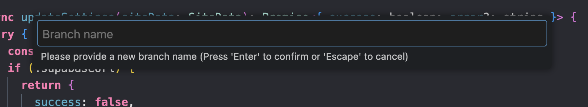
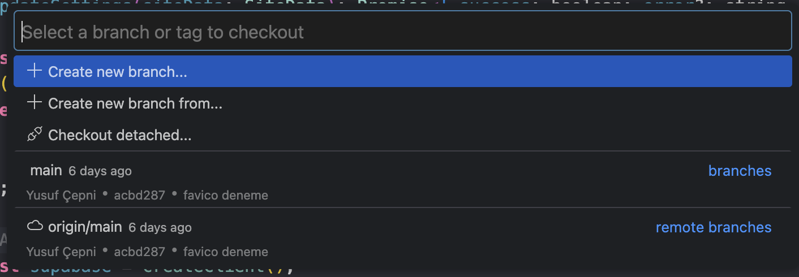
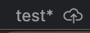

# 🐟 Sahil Balık Ekmek — Kurumsal Web Sitesi & Çalıştırma Rehberi

Dikili / İzmir'de bulunan **Sahil Balık Ekmek** restoranı için geliştirilmiş modern, boutique ve yüksek performanslı kurumsal web sitesi.

Proje **Next.js 15 (App Router)**, **TypeScript**, **TailwindCSS 4**, **Framer Motion** ve **Supabase (Auth + Database + RLS)** altyapısıyla hazırlanmıştır.

---

## 📋 İçindekiler
1. [💻 Projeyi Bilgisayara İndirme ve Çalıştırma (Başlangıç Rehberi)](#-projeyi-bilgisayara-indirme-ve-çalıştırma-başlangıç-rehberi)
2. [🌿 Sitede Güncelleme Yapma & Git Branch Rehberi](#-sitede-güncelleme-yapma--git-branch-rehberi)
3. [🛠️ Teknolojiler ve Mimari](#️-teknolojiler-ve-mimari)
4. [🗄️ Supabase Veritabanı Kurulumu](#️-supabase-veritabanı-kurulumu)
5. [🚀 Vercel Üzerinde Yayınlama (Deploy)](#-vercel-üzerinde-yayınlama-deploy)
6. [📂 Dosya ve Klasör Mimarisi](#-dosya-ve-klasör-mimarisi)

---

## 💻 Projeyi Bilgisayara İndirme ve Çalıştırma (Başlangıç Rehberi)

Projeyi kendi bilgisayarınızda çalıştırıp incelemek ve güncellemeler yapmak için aşağıdaki adımları sırasıyla uygulayabilirsiniz.

### 1. Adım: Projeyi Bilgisayara İndirme (Git Clone)
Bilgisayarınızda **Terminal** (Mac) veya **Komut İstemi / PowerShell** (Windows) uygulamasını ya da **VS Code** terminalini açın. Projeyi indirmek istediğiniz klasöre gidin ve şu komutu çalıştırın:

```bash
git clone https://github.com/KULLANICI_ADI/sahil-balik-ekmek.git
```

İndirme tamamlandıktan sonra proje klasörünün içine girin:

```bash
cd sahil-balik-ekmek
```

---

### 2. Adım: Projeyi Kod Editöründe (VS Code) Açma
1. **Visual Studio Code** (VS Code) programını açın.
2. Üst menüden **File -> Open Folder...** (Dosya -> Klasörü Aç...) seçeneğine tıklayın.
3. Bilgisayarınıza indirdiğiniz `sahil-balik-ekmek` klasörünü seçip açın.

---

### 3. Adım: Gerekli Paketleri Yükleme (`npm install`)
Projenin çalışabilmesi için gerekli kütüphanelerin bilgisayarınıza yüklenmesi gerekir.

1. VS Code içerisinde en üst menüden **Terminal -> New Terminal** seçeneğine tıklayın (veya `Ctrl + ~` kısayolunu kullanın).
2. Açılan siyah/koyu renkli terminal ekranına aşağıdaki komutu yazıp **Enter** tuşuna basın:

```bash
npm install
```

> 💡 *Bu işlem birkaç dakika sürebilir. İndirme bittiğinde terminalde yeni bir satır açılacaktır.*

---

### 4. Adım: Ortam Değişkenlerini (Environment Variables) Hazırlama
Supabase veritabanı bağlantısı için proje ana dizininde bulunan `.env.example` dosyasının bir kopyasını oluşturup adını `.env.local` yapın:

```bash
cp .env.example .env.local
```

Oluşturduğunuz `.env.local` dosyasının içine Supabase URL ve Anon Key bilgilerinizi ekleyin:
```env
NEXT_PUBLIC_SUPABASE_URL=https://xxxx.supabase.co
NEXT_PUBLIC_SUPABASE_ANON_KEY=eyJhbGciOiJIUzI...
```

---

### 5. Adım: Projeyi Local'de (Kendi Bilgisayarınızda) Çalıştırma
Tüm paketler yüklendikten sonra siteyi kendi bilgisayarınızda canlı olarak başlatmak için terminale şu komutu yazın:

```bash
npm run dev
```

Terminal ekranında `Ready in ... ms` ve `http://localhost:3000` yazısını gördüğünüzde siteniz bilgisayarınızda çalışıyor demektir!

---

### 6. Adım: Siteyi Tarayıcıda (Google Chrome) Açma
1. **Google Chrome**, **Safari** veya kullandığınız tarayıcıyı açın.
2. Üstteki adres çubuğuna (URL kısmına) aşağıdaki adresi yazıp **Enter**'a basın:

👉 **`http://localhost:3000`**

Artık siteyi kendi bilgisayarınızda canlı olarak görebilir, test edebilir ve düzenlemeler yapabilirsiniz!

---

## 🌿 Sitede Güncelleme Yapma & Git Branch Rehberi

Sitede bir değişiklik yapacağınız zaman (örneğin yeni metin ekleme, fotoğraf değiştirme veya fiyat güncelleme) direkt ana kod üzerinde çalışmak yerine **kendinize özel bir dal (branch)** oluşturmalısınız. Bu sayede ana siteye zarar vermeden güvenle çalışabilirsiniz.

### 1. Adım: Yeni Bir Branch (Dal) Oluşturma

GitHub arayüzünden veya VS Code üzerinden sol alt kısımdaki dallar butonuna tıklayarak yeni bir branch başlatabilirsiniz.



*Terminal üzerinden yapmak isterseniz:*
```bash
git checkout -b guncelleme-menu
```

---

### 2. Adım: Branch'inize İsim Verme

Yapacağınız güncellemeye uygun, Türkçe karakter içermeyen kısa bir isim verin (Örn: `yeni-fotograflar`, `fiyat-guncellemesi`, `iletisim-bilgisi`).



---

### 3. Adım: Değişiklikleri Kaydetme ve GitHub'a Yükleme (Push)

Sitede değişikliklerinizi tamamladıktan sonra terminalden aşağıdaki 3 kısa komut ile çalışmalarınızı yükleyin:

```bash
# 1. Yapılan tüm değişiklikleri ekle
git add .

# 2. Değişiklik için kısa bir açıklama notu yaz
git commit -m "Menü fiyatları güncellendi"

# 3. Kendi branch'ini GitHub'a yükle
git push origin SIZIN_BRANCH_ADINIZ
```

GitHub ekranında yaptığınız yükleme aşağıdaki gibi görünecektir:



---

### 4. Adım: GitHub'da Pull Request (PR) Açma
1. [GitHub repository](https://github.com) sayfanıza gidin.
2. Ekranın üst kısmında çıkan **"Compare & pull request"** butonuna tıklayın.
3. Yaptığınız değişiklikleri kısaca açıklayıp **"Create pull request"** butonuna basın.
4. Kontroller sağlandıktan sonra değişiklikleriniz ana siteye güvenle aktarılacaktır!

---

## 🛠️ Teknolojiler ve Mimari

- **Frontend**: Next.js 15 (App Router), React 19, TypeScript
- **Styling**: TailwindCSS 4, Custom Design Tokens & Ocean Glassmorphism Theme
- **Animasyonlar**: Framer Motion (Doğal deniz canlıları, yüzücü balık sürüleri, kabarcıklar, SVG wave dividers)
- **Backend / Veritabanı**: Supabase PostgreSQL & Auth
- **SEO**: Dynamic Metadata, OpenGraph, JSON-LD Schema (Restaurant & LocalBusiness), Sitemap, Robots.txt
- **Performans**: next/image AVIF/WebP, Lazy Loading, High-contrast WCAG okunaklı tipografi

---

## 🗄️ Supabase Veritabanı Kurulumu

Projeyi klonlayan geliştiriciler veritabanı kurulumu için aşağıdaki adımları izleyebilir:

1. [supabase.com](https://supabase.com) adresinde ücretsiz bir proje oluşturun (`sahil-balik-ekmek`).
2. **Project Settings -> API** altından `Project URL` ve `anon public key` değerlerini alın.
3. Supabase Dashboard'da **SQL Editor** sekmesine gidin.
4. Proje dizininde yer alan [`supabase/schema.sql`](./supabase/schema.sql) dosyasındaki kodları yapıştırıp **Run** butonuna basın.
   - Bu işlem `settings` tablosunu oluşturur, varsayılan verileri yükler (Seed) ve Row Level Security (RLS) kurallarını aktif eder.
5. **Authentication -> Users** menüsünden **Add user -> Create user** diyerek ilk admin kullanıcısını ekleyin.

---

## 🚀 Vercel Üzerinde Yayınlama (Deploy)

1. Projeyi GitHub reponuza yükleyin.
2. [Vercel Dashboard](https://vercel.com) üzerinde **Add New -> Project** diyerek reponuzu bağlayın.
3. **Environment Variables** kısmına `.env.local` içerisindeki değişkenleri ekleyin:
   - `NEXT_PUBLIC_SUPABASE_URL`
   - `NEXT_PUBLIC_SUPABASE_ANON_KEY`
4. **Deploy** butonuna basın. Vercel projenizi otomatik derleyip canlıya alacaktır.

---

## 📂 Dosya ve Klasör Mimarisi

```
├── app/
│   ├── page.tsx               # Ana Sayfa (Dynamic Supabase Settings)
│   ├── hakkimizda/page.tsx    # Hakkımızda
│   ├── iletisim/page.tsx      # İletişim & Konum
│   ├── admin/
│   │   ├── page.tsx           # Supabase Admin Dashboard
│   │   └── login/page.tsx     # Supabase Auth Admin Login Formu
│   ├── layout.tsx             # Root Layout & SEO Meta
│   ├── globals.css            # TailwindCSS 4 & Design System
│   ├── sitemap.ts             # Dynamic Sitemap
│   └── robots.ts              # SEO Robots.txt
├── components/
│   ├── home/                  # Hero, About, WhyUs, Gallery, Hours, Location
│   ├── layout/                # Navbar, Footer
│   └── ui/                    # SeaCreatures, OceanBubbles, Waves, Button, Card
├── lib/
│   └── supabase/
│       ├── client.ts          # Browser Supabase Client
│       ├── server.ts          # Server Supabase Client (SSR)
│       └── middleware.ts      # Auth protection for /admin
├── services/
│   └── settings.service.ts    # Supabase Settings Service (CRUD)
├── types/
│   ├── database.types.ts      # Supabase DB TypeScript Interfaces
│   └── index.ts               # App TypeScript Interfaces
├── supabase/
│   └── schema.sql             # DB Creation, Seed & RLS Policies
├── data/
│   └── siteData.ts            # Default Fallback Site Data
├── public/
│   └── gallery/               # Site ve rehber görselleri (branch-name, branch-new, branch-yukle vb.)
├── .env.example               # Environment Variables Template
└── README.md                  # Kurulum ve Dağıtım Dokümantasyonu
```

---

## 📜 Lisans & Telif

© 2026 **Sahil Balık Ekmek**. Tüm hakları saklıdır. Dikili / İzmir.
